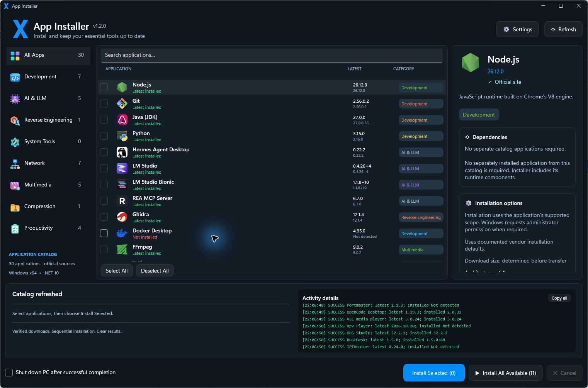

<div align="center">
  
  <h1>X App Installer</h1>
  <p><strong>Install your essential Windows tools. Keep their dependencies in check.</strong></p>
  <p>A native Windows application manager built with C#, .NET 10 and WinUI 3.</p>
  <p>
    
    
    
    
  </p>
  <p><a href="#getting-started">Getting started</a> · <a href="#supported-applications">App catalog</a> · <a href="#build-from-source">Build</a> · <a href="CHANGELOG.md">Changelog</a></p>
</div>



## Overview

X App Installer brings software discovery, release checks and installation into one desktop interface. Choose the tools you need, review their requirements and follow a sequential installation queue with visible progress and clear results.

### Highlights

- **30 applications** across development, AI, networking, multimedia and productivity.
- **Dependency-aware installation** with automatic prerequisite selection, version constraints and conflict detection.
- **Fast local discovery** through installed-app records, managed deployments and a bounded scan of common portable-app folders.
- **Current release checks** using upstream feeds and official repositories, with explicit stale-cache status when a source is temporarily unavailable.
- **Verified downloads** with HTTPS host validation, release checksums and Windows signature policies.
- **Readable activity logs** with green success messages, yellow warnings, red errors, selectable text and Copy all.
- **Self-contained Windows x64 builds** with the .NET and Windows App SDK runtime files included.

## Getting started

### Run a packaged build

1. Extract the complete `X-App-Installer-1.2.0-win-x64.zip` into a folder you can write to.
2. Run `XAppInstaller.exe` from that folder.
3. Refresh the catalog, select applications and choose **Install Selected**.
4. Complete a vendor's setup window or Windows administrator prompt when requested.

Keep the entire extracted folder together: the EXE needs its accompanying runtime, resource and asset files. Git and a separate .NET installation are not required to run the packaged build. Internet access is needed for release checks and downloads.

The application targets Windows x64 and the Windows 10 build 19041 API baseline. Individual applications can have stricter Windows, hardware or runtime requirements.

When working from the project checkout, `Launch.cmd` opens the most recently built release.

## Supported applications

The catalog is maintained in [`catalog/apps.json`](catalog/apps.json). Each entry declares its release source, installation format, detection rules and dependency notes.

| Category | Applications |
| --- | --- |
| Development | Node.js, Git, Java (JDK), Python, Docker Desktop, Visual Studio Code, DBeaver Community |
| AI & LLM | Hermes Agent Desktop, LM Studio, LM Studio Bionic, REA MCP Server, OpenCode Desktop |
| Reverse Engineering | Ghidra |
| Multimedia | FFmpeg, VLC media player, mpv Player, OBS Studio, IPTVnator |
| Compression | 7-Zip |
| Productivity | Notepad++, Flameshot, Lightshot, ShareX |
| Network | WinSCP, PuTTY, Advanced Port Scanner, Wireshark, Sniffnet, Portmaster, RustDesk |

Application versions are resolved from upstream sources rather than fixed to the versions shown in the screenshot. Third-party applications retain their own licenses and requirements.

### Installation status

| Status | Meaning |
| --- | --- |
| **Latest installed** — green | The detected version meets the confirmed release version; its checkbox is disabled. |
| **Newer version available** — yellow | An update is available and can be selected. |
| **Not installed** — red | No compatible installation was detected in the locations checked. |
| **Latest unconfirmed / cached** | Cached information is shown explicitly; it does not establish that an installed copy is current. |

### Dependency examples

- **REA MCP Server:** its default Windows profile requires Node.js, a compatible JDK and Ghidra. Missing prerequisites are ordered before REA.
- **Ghidra:** Java requirements are read from the selected release's own metadata.
- **DBeaver Community:** uses its bundled Java runtime instead of forcing another system JDK.
- **Sniffnet:** requires Npcap in WinPcap-compatible mode; Wireshark itself is not a mandatory dependency.
- **IPTVnator:** MPV and VLC are optional external playback engines.
- **mpv Player:** uses the standard x64 shinchiro Windows build linked by mpv.io. It is a third-party development build, identified by its build date; archive extraction is built in.

## Build from source

Development requires Windows, the .NET 10 SDK and the Windows application build tools needed by WinUI 3. NuGet restores the project's Windows App SDK and other package references.

```powershell
git clone https://github.com/7byteDev/x_app_installer.git
cd x_app_installer
.\Build.ps1
```

`Build.ps1` builds the solution, runs deterministic checks and publishes a self-contained x64 release. Outputs stay in the project folder:

```text
artifacts/
  release-1.2.0/          # Complete runnable application
    XAppInstaller.exe
    release.json         # Version, Git revision and build hashes
  current-release.txt    # Release selected by Launch.cmd
X-App-Installer-1.2.0-win-x64.zip
X-App-Installer-1.2.0-win-x64.zip.sha256
```

To verify a packaged build:

```powershell
Get-FileHash .\X-App-Installer-1.2.0-win-x64.zip -Algorithm SHA256
Get-Content .\X-App-Installer-1.2.0-win-x64.zip.sha256
```

### Validation

```powershell
# Core checks; does not run real vendor installers
dotnet run --project src/AppInstaller.Checks -c Release -- $PWD.Path

# Resolve one provider, download its real package and verify integrity
dotnet run --project src/AppInstaller.Checks -c Release -- $PWD.Path --network --download --only=iptvnator
```

The 1.2.0 addition passed 68 core/live-download checks and 19 published UI checks. Download verification is distinct from completing every vendor installation on every Windows configuration. Historical validation reports in `docs/` describe the scope and limitations of each test run.

## Download and installation policy

- Downloads must use HTTPS and the provider's allowed hosts, including validated redirects.
- Archive packages require an authoritative SHA-256 or SHA-512 checksum.
- Executable installers follow their configured Windows Authenticode policy. Selected unsigned upstream packages are accepted only when an authoritative SHA-256 is available; this does not allow invalid signed certificates.
- The application checks installed versions after setup; simply launching or cancelling a wizard is not treated as success.
- Windows administrator permission is requested only when an installer needs it.
- Retry, Skip and Cancel control the queue. A running system installer is allowed to finish before remaining work is cancelled.

Settings, managed tools and activity logs are stored under `%LOCALAPPDATA%\XAppInstaller`. Portable discovery checks common locations with a time/depth limit rather than scanning every file on every drive. See the detection notes if an application is installed in an unusual folder.

## Versioning

[`Version.props`](Version.props) is the single source of truth for the app version. Releases follow `major.minor.patch` and are marked with Git tags. The app displays its version in the header and build details in Settings; release manifests record the source revision.

```powershell
.\Set-Version.ps1 -Bump Patch -WhatIf  # Preview the next version
.\Set-Version.ps1 -Bump Patch          # Apply it
```

Update the [changelog](CHANGELOG.md), commit the source and run `Build.ps1` before tagging a release. See the [version-control guide](docs/VERSION-CONTROL.md) for the complete workflow.

## Project structure

| Area | Responsibility |
| --- | --- |
| `AppInstaller.UI` | WinUI 3 interface and MVVM view models |
| `AppInstaller.Providers` | Official release feeds and metadata caching |
| `AppInstaller.DependencyResolver` | Dependency ordering and version constraints |
| `AppInstaller.Downloads` / `Security` | Transfers, trusted hosts, checksums and signature verification |
| `AppInstaller.Installation` | Detection, prerequisites, vendor setup and portable deployments |
| `AppInstaller.Models` / `Core` / `Logging` | Shared contracts and activity records |
| `AppInstaller.Checks` | Core and opt-in integration checks |

## Documentation

- [Architecture](docs/ARCHITECTURE.md)
- [Dependency audit](docs/DEPENDENCY-AUDIT.md)
- [Version control and releases](docs/VERSION-CONTROL.md)
- [Application icon sources](docs/APP-ICON-SOURCES.md)
- [Multimedia providers](docs/MEDIA-APPS.md)
- [IPTVnator provider](docs/IPTVNATOR.md)

## Contributing

Open an issue with the affected application, the installer version and the relevant activity message. Remove personal paths, credentials and playlist URLs from diagnostic material before sharing it. For provider changes, include authoritative upstream sources and run the applicable checks.

---

Developed by **Özgür Ulusoy** · [7byte.dev](https://7byte.dev)

Application names, logos and trademarks belong to their respective owners.
